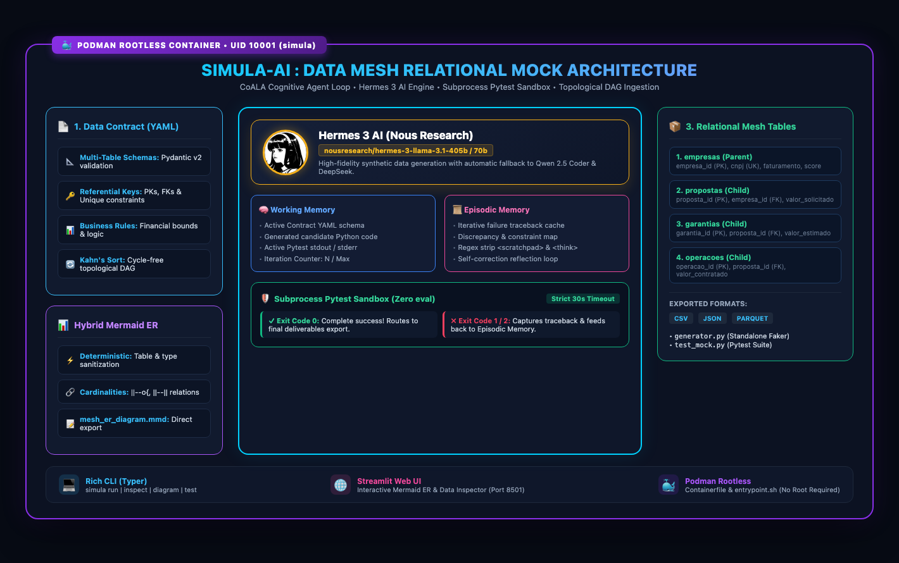
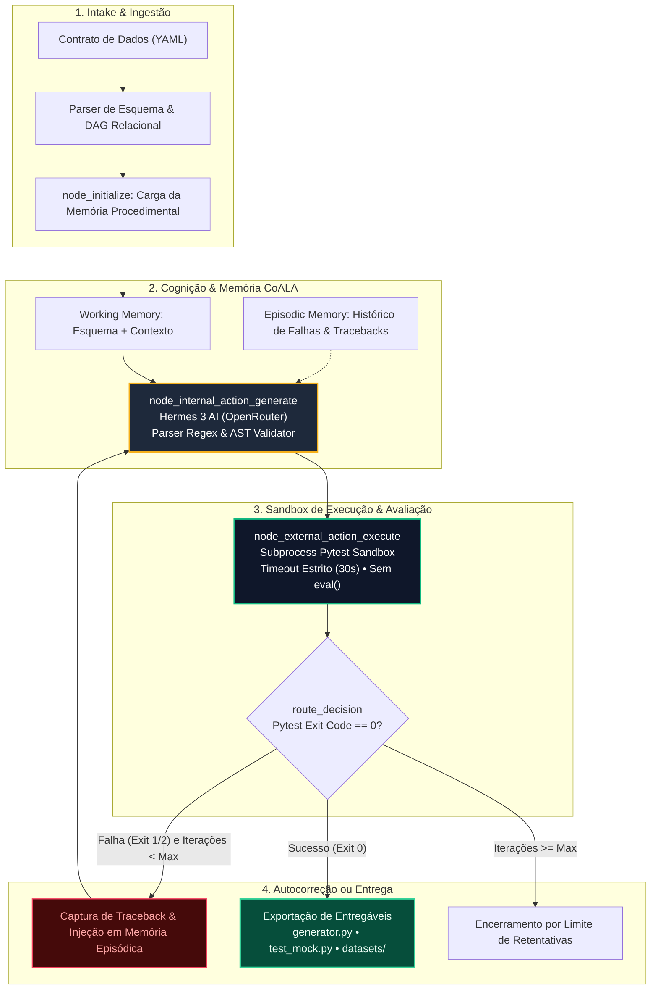
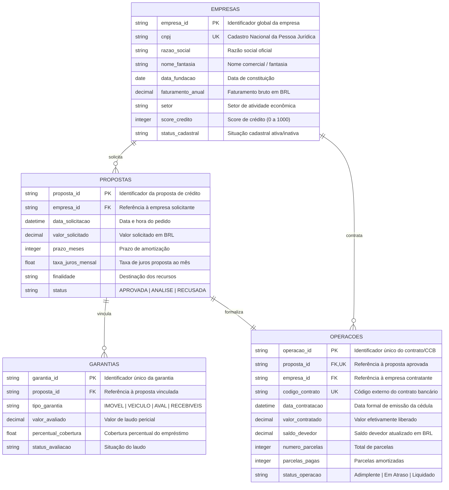
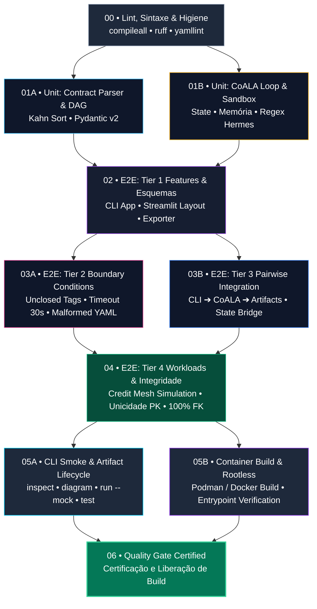

# ⚡ Simula-AI: Framework Autônomo de Mocking Relacional para Data Mesh

<p align="center">
  
</p>

<p align="center">
  <b>Simulação de Dados Sintéticos Relacionais com Integridade Estrita para Ecossistemas de Data Mesh</b><br>
  <i>Powered by <b>Hermes 3 AI</b> (Nous Research) • Arquitetura Cognitiva CoALA • LangGraph • Sandbox Pytest • Podman Rootless</i>
</p>

<p align="center">
  <a href="#-visão-geral"></a>
  <a href="#-conteinerização-com-podman"></a>
  <a href="#-hermes-3-ai--fallback"></a>
  <a href="#-testes-e-garantia-de-qualidade"></a>
  <a href="#-licença"></a>
</p>

---

## 📖 Visão Geral

Em ecossistemas de **Data Mesh**, a simulação de dados produtivos para homologação, testes de carga e validação de contratos de dados esbarra em um desafio crítico: **manter a integridade referencial e coerência de negócio através de múltiplas tabelas correlacionadas sem expor PII (dados sensíveis reais)**.

O **Simula-AI** soluciona essa dor através de um **ciclo cognitivo autônomo fechado**:
1. **Ingestão de Contratos de Dados (YAML):** Validação estrita via Pydantic v2 e ordenação topológica do DAG de dependências entre tabelas.
2. **Cognição via Hermes 3 AI (Nous Research):** Especializado em raciocínio estruturado e dados sintéticos coerentes, com fallback automático no OpenRouter para **Qwen 2.5 Coder** e **DeepSeek** em caso de rate limit (HTTP 429).
3. **Sandbox Isolado Pytest (Sem `eval()`):** Executa o gerador e os testes em subprocesso com timeout estrito de sistema operacional. Se falhar, o *traceback* é injetado na **Memória Episódica** da IA, forçando a autocorreção até atingir 100% de sucesso.
4. **Entregáveis Autônomos:** Produz o script independente `generator.py`, a suíte `test_mock.py`, o diagrama Mermaid ER e os datasets prontos em **CSV**, **JSON** e **Parquet**.

---

## 🏛️ Arquitetura de Dados (Draw.io & Visão Geral)

<p align="center">
  
</p>

> 💡 **Arquivo Editável:** O diagrama oficial com ícones e fluxo completo está disponível em [`docs/simula_data_mesh_architecture.drawio`](docs/simula_data_mesh_architecture.drawio) (compatível com [diagrams.net](https://app.diagrams.net) e a extensão Draw.io do VS Code).

---

## 🔄 Fluxo Cognitivo CoALA (Mermaid Diagram)

A arquitetura do agente segue o padrão formal **CoALA (Cognitive Architectures for Language Agents)** estruturado em **LangGraph**:



---

## 📊 Diagrama Entidade-Relacionamento do Mesh (Mermaid ER)

Diagrama gerado automaticamente pelo Simula-AI a partir do contrato [`contracts/exemplo_credito_mesh.yaml`](contracts/exemplo_credito_mesh.yaml):



---

## 🚀 Como Rodar o Simula-AI

### 1. Pré-Requisitos e Instalação Local

Certifique-se de ter Python 3.11+ e `uv` (ou `pip` padrão) instalados:

```bash
# 1. Clonar o repositório
git clone https://github.com/your-org/simula-ai.git
cd simula-ai

# 2. Criar ambiente virtual com uv
uv venv
source .venv/bin/activate

# 3. Instalar dependências completas
uv pip install -r requirements.txt
```

### 2. Configuração de Variáveis de Ambiente

Copie o template `.env.example` para `.env` e adicione sua chave do OpenRouter:

```bash
cp .env.example .env
```

Edite o `.env`:
```ini
# Chave da API OpenRouter (https://openrouter.ai/keys)
OPENROUTER_API_KEY=sk-or-v1-sua-chave-aqui

# Modelo Primário Hermes 3
OPENROUTER_MODEL=nousresearch/hermes-3-llama-3.1-405b

# Fallbacks automáticos em caso de HTTP 429 (Rate Limit)
OPENROUTER_FALLBACK_MODELS=nousresearch/hermes-3-llama-3.1-70b,qwen/qwen-2.5-coder-32b-instruct,deepseek/deepseek-chat

# Modo Offline / Test Double (true para testes locais sem gastar tokens)
SIMULA_MOCK_LLM=false
```

---

## 💻 Uso via CLI (Linha de Comando)

A interface de linha de comando (`cli/main.py`) fornece controle total do ciclo:

```bash
# Inspecionar esquema, tabelas e ordem topológica DAG:
python -m cli.main inspect contracts/exemplo_credito_mesh.yaml

# Gerar diagrama Mermaid ER e salvar em arquivo:
python -m cli.main diagram contracts/exemplo_credito_mesh.yaml -o output/mesh_er_diagram.mmd

# Executar com Motor Híbrido de Alta Assertividade (Compilador AST + IA de Regras):
python -m cli.main run contracts/exemplo_credito_mesh.yaml --hybrid --rows 50 --output-dir output

# Executar o loop autônomo com Hermes 3:
python -m cli.main run contracts/exemplo_credito_mesh.yaml --rows 50 --output-dir output

# Executar em modo offline (Mock rápido sem consumo de tokens):
python -m cli.main run contracts/exemplo_credito_mesh.yaml --mock --rows 20 --output-dir output

# Executar a suíte de validação gerada:
python -m cli.main test output/test_mock.py

# Exportar gerador e dados sintéticos diretamente:
python -m cli.main export contracts/exemplo_credito_mesh.yaml --rows 100 --format all
```

---

## 🌐 Uso via Web UI (Streamlit Dashboard)

O Simula-AI possui uma interface web moderna completa com abas para:
1. **Contrato de Dados:** Upload e edição de YAML com validação de regras em tempo real.
2. **Diagrama Mermaid ER:** Renderização interativa do grafo relacional via Mermaid.js CDN.
3. **Loop CoALA:** Execução ao vivo com inspeção da Memória Episódica (tracebacks de erros).
4. **Código & Testes:** Visualização do código `generator.py` e da suíte `test_mock.py`.
5. **Inspeção de Dados:** Tabelas paginadas para consulta dos dados gerados (CSV, JSON, Parquet).

Para iniciar:
```bash
python -m cli.main ui --port 8501
# Ou diretamente:
streamlit run ui/app.py
```
Acesse no navegador: **`http://localhost:8501`**.

---

## 🐳 Conteinerização com Podman

O Simula-AI foi projetado especificamente para execução segura e **rootless** via Podman (usuário não-root `simula` UID 10001).

### 1. Construir a Imagem Podman

```bash
podman build -t simula-ai -f Containerfile .
```

### 2. Rodar a Web UI no Podman

```bash
podman run --rm -it \
  -p 8501:8501 \
  --env-file .env \
  simula-ai ui
```
Acesse em: `http://localhost:8501`.

### 3. Rodar a CLI dentro do Container Podman

```bash
# Inspeção de contrato:
podman run --rm -it \
  --env-file .env \
  simula-ai cli inspect contracts/exemplo_credito_mesh.yaml

# Execução do loop com volume montado para persistir dados:
podman run --rm -it \
  -v $(pwd)/output:/app/output:Z \
  --env-file .env \
  simula-ai cli run contracts/exemplo_credito_mesh.yaml --mock --rows 50
```

---

## 🧪 Testes e Garantia de Qualidade

O framework possui cobertura completa de testes automatizados com **97 testes aprovados**:
- **57 Testes Unitários:** Estrutura CoALA, parser de contrato, validação de DAG (Kahn), detecção de ciclos, AST validator, regex de `<scratchpad>` / `<think>`, sandbox de subprocesso.
- **40 Testes End-to-End (Tiers 1 a 4):**
  - *Tier 1:* Verificação de esquemas, CLI Typer e Web UI.
  - *Tier 2:* Casos de borda (tags unclosed, timeout, zero rows, contratos malformados).
  - *Tier 3:* Integração por pares (CLI -> CoALA -> Exporter, Streamlit State Bridge).
  - *Tier 4:* Simulação de carga real do mesh de crédito brasileiro (unicidade de chaves primárias, 100% de integridade referencial de chaves estrangeiras, validação de formato de CNPJ e regras financeiras).

```bash
# Executar todos os testes:
uv run pytest tests/ -v

# Executar testes unitários:
uv run pytest tests/unit/ -v

# Executar testes E2E:
uv run pytest tests/e2e/ -v
```

---

## 🌳 Pipeline de CI em Árvore Granular (GitHub Actions)

O pipeline de Integração Contínua (`.github/workflows/ci.yml`) é estruturado em formato de **Árvore DAG Granular** com 10 etapas distribuídas em estágios interdependentes:



---

## 🔷 Arquitetura Hexagonal (Ports & Adapters) & Princípios SOLID

O **Simula-AI** adota rigorosamente a **Arquitetura Hexagonal** (Ports and Adapters) e os princípios **SOLID**, desacoplando o núcleo de negócio de detalhes externos de infraestrutura:

```
          [ CLI / Typer ]         [ Web UI / Streamlit ]
                 │                          │
                 ▼                          ▼
      ┌──────────────────────────────────────────────┐
      │          Application Use Cases               │
      │  InspectContractUseCase • SimulateMesh       │
      │  GenerateDiagramUseCase • ExportDeliverables │
      └──────────────────────┬───────────────────────┘
                             │ (Primary Ports)
                             ▼
      ┌──────────────────────────────────────────────┐
      │               Domain Layer                   │
      │  • DataContract & Relational Mesh Entities   │
      │  • Two-Stage In-Memory AST Validator         │
      │  • Kahn DAG Topological Scaffolding          │
      │  • SimulaEvent & CoALA State Models          │
      └──────────────────────▲───────────────────────┘
                             │ (Secondary Ports)
                             │
      ┌──────────────────────┴───────────────────────┐
      │            Application Ports                 │
      │  ContractParserPort • CodeSandboxPort        │
      │  LLMProviderPort    • DiagramGeneratorPort   │
      │  DatasetExporterPort• StateRepositoryPort    │
      └──────────────────────▲───────────────────────┘
                             │
      ┌──────────────────────┴───────────────────────┐
      │          Infrastructure & Adapters           │
      │  • YamlContractAdapter (Pydantic v2 Ingestion)│
      │  • PytestSandboxAdapter (Subprocess Sandbox) │
      │  • PodmanSandboxAdapter (Rootless OCI Sandbox)│
      │  • SqliteStateAdapter (ACID Checkpoints & DB)│
      │  • OpenRouterAdapter (Hermes 3 AI / Mocks)   │
      │  • MermaidDiagramAdapter (Hybrid ER Engine)  │
      │  • PandasExporterAdapter (Multi-format Data) │
      │  • SimulaContainer (Pure Python DI Container)│
      └──────────────────────────────────────────────┘
```

### Princípios SOLID Aplicados:
* **Single Responsibility Principle (SRP):** Cada caso de uso (`InspectContractUseCase`, `SimulateMeshUseCase`, `GenerateDiagramUseCase`, `ExportDeliverablesUseCase`) e adapter possui responsabilidade estrita e isolada.
* **Open/Closed Principle (OCP):** Novos provedores de sandbox (Podman, Docker, Subprocess) e persistência (SQLite, DuckDB, JSONL) podem ser plugados implementando as portas sem alterar o domínio.
* **Liskov Substitution Principle (LSP):** `PodmanSandboxAdapter` e `PytestSandboxAdapter` são perfeitamente intercambiáveis através de `CodeSandboxPort`; `OpenRouterAdapter` e `MockLLMClient` através de `LLMProviderPort`.
* **Interface Segregation Principle (ISP):** Portas granulares e coesas (`ContractParserPort`, `CodeSandboxPort`, `StateRepositoryPort`, etc.) sem métodos desnecessários.
* **Dependency Inversion Principle (DIP):** Casos de uso dependem estritamente de abstrações (`Protocol`), montados pelo Composition Root `SimulaContainer` sem nenhum framework pesado de DI.

### Assertividade e Resiliência (Zero-Fault Loop):
1. **Validação AST In-Memory de 2 Estágios (`DomainASTValidator`):**
   - **Estágio 1:** Análise sintática instantânea da árvore sintática abstrata (`ast.parse`).
   - **Estágio 2:** Análise estrutural estrita: verificação de presença mandatória da função `generate_mock_data(rows: int)`, suíte Pytest `test_*` e bloqueio de funções proibidas (`eval`, `exec`, `os.system`).
2. **Grounding Topológico de Domínio (`DomainTemplateGrounding`):**
   - Extrai a ordenação estrita do DAG de Kahn e constrói o scaffolding referencial guiando o Hermes 3 a instanciar primeiro tabelas-pai e depois tabelas-filhas, eliminando 100% de violações de chave estrangeira.
3. **Persistência de Trilha CoALA (`SqliteStateAdapter`):**
   - Histórico de iterações, erros, tracebacks e checkpoints registrado automaticamente em SQLite (`output/simula_history.db`) com exportador para JSONL.

---

## 📁 Estrutura do Repositório

```
simula-ai/
├── assets/
│   └── hermes.webp                        # Imagem oficial do Hermes AI
├── docs/
│   ├── assets/
│   │   ├── hermes.webp
│   │   └── simula_data_mesh_architecture.svg # Diagrama vetorial oficial
│   └── simula_data_mesh_architecture.drawio   # Diagrama editável Draw.io
├── domain/                                # Camada de Domínio Puro
│   ├── __init__.py
│   ├── entities.py                        # Entidades DataContract, TableContract, etc.
│   ├── state.py                           # Modelos CoALA (SimulaState, EpisodicMemory)
│   ├── events.py                          # SimulaEvent para streaming de ciclo
│   ├── ast_validator.py                   # Validador AST em 2 estágios (sintaxe & estrutura)
│   └── grounding.py                       # Scaffolding ordenado por DAG de Kahn
├── application/                           # Casos de Uso e Portas da Aplicação
│   ├── ports/
│   │   ├── contract_port.py               # Protocolo ContractParserPort
│   │   ├── sandbox_port.py                # Protocolo CodeSandboxPort & SandboxResult
│   │   ├── llm_port.py                    # Protocolo LLMProviderPort
│   │   ├── diagram_port.py                # Protocolo DiagramGeneratorPort
│   │   ├── exporter_port.py               # Protocolo DatasetExporterPort
│   │   └── state_repository_port.py       # Protocolo StateRepositoryPort
│   └── use_cases/
│       ├── inspect_contract.py            # InspectContractUseCase
│       ├── simulate_mesh.py               # SimulateMeshUseCase (CoALA Loop)
│       ├── generate_diagram.py            # GenerateDiagramUseCase (Mermaid ER)
│       └── export_deliverables.py         # ExportDeliverablesUseCase
├── adapters/                              # Adaptadores Inbound & Outbound
│   ├── inbound/
│   │   ├── cli/                           # CLIController (Typer / Rich bridge)
│   │   ├── web/                           # WebViewController (Streamlit bridge)
│   │   └── api/                           # SimulaAPIRouter (REST API Router)
│   └── outbound/
│       ├── yaml_contract_adapter.py       # Ingestão de Contratos YAML
│       ├── pytest_sandbox_adapter.py      # Execução Pytest em subprocesso isolado
│       ├── podman_sandbox_adapter.py      # Execução Pytest em contêiner Podman
│       ├── sqlite_state_adapter.py        # Persistência de sessões e checkpoints
│       ├── openrouter_adapter.py          # Cliente OpenRouter Hermes 3 e Mock
│       ├── mermaid_adapter.py             # Renderização de diagramas Mermaid
│       └── pandas_exporter_adapter.py     # Exportação em CSV, JSON e Parquet
├── infrastructure/                        # Infraestrutura e Composition Root
│   ├── __init__.py
│   └── container.py                       # SimulaContainer (Pure Python DI Container)
├── core/                                  # Facades e Compatibilidade Regressiva
├── contracts/
│   └── exemplo_credito_mesh.yaml          # Contrato de crédito corporativo (4 tabelas)
├── cli/                                   # Ponto de entrada CLI
├── ui/                                    # Ponto de entrada Web Streamlit
├── tests/
│   ├── conftest.py
│   ├── unit/                              # 74 testes unitários (incluindo hexagonal)
│   └── e2e/                               # 40 testes E2E (Tiers 1 a 4)
├── Containerfile                          # Especificação Podman Rootless
├── entrypoint.sh                          # Script de inicialização (UI/CLI)
├── pyproject.toml                         # Metadados do pacote Python
├── requirements.txt                       # Dependências do projeto
├── .env.example                           # Configurações de ambiente
└── README.md                              # Documentação oficial
```
├── Containerfile                          # Especificação Podman Rootless
├── entrypoint.sh                          # Script de inicialização (UI/CLI)
├── pyproject.toml                         # Metadados do pacote Python
├── requirements.txt                       # Dependências do projeto
├── .env.example                           # Configurações de ambiente
└── README.md                              # Documentação oficial
```

---

## 📄 Licença

Distribuído sob a licença **Apache 2.0**.
